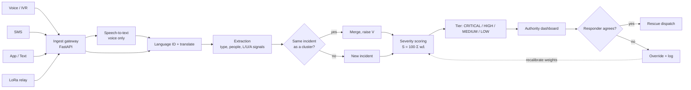

# Architecture

## Pipeline

## Code map

| Stage | Module |
|---|---|
| Ingest | `backend/app/api/reports.py` |
| Speech-to-text | `backend/app/services/stt.py` |
| Translation | `backend/app/services/translate.py` |
| Extraction | `backend/app/services/extraction.py` |
| Embeddings | `backend/app/services/embeddings.py` |
| Duplicate detection | `backend/app/services/dedup.py` |
| Scoring | `backend/app/services/scoring.py` |
| Orchestration | `backend/app/services/pipeline.py` |
| Ranked queue, override, status | `backend/app/api/incidents.py` |
| LoRa Packet Codec | `backend/app/services/packet_codec.py` |
| Simulation & Demo Scenarios | `backend/app/demo.py` |
| Dashboard | `frontend/src/App.jsx` |

## Design decisions

**Adapters with offline fallbacks.** STT, translation and embeddings sit behind small protocols.
The defaults need no model download, so the project runs and tests on any laptop; real models
are switched on with environment variables and `requirements-ml.txt`.

**Transparent scoring.** The score is a weighted sum of five named factors, and the API returns
the factor breakdown with every incident. A responder can see why something ranked where it did.

**Human in the loop.** Overrides change the *effective* tier but never overwrite the AI tier, and
each one is written to `override_logs` for later weight calibration.

**Factors take the strongest evidence in a cluster.** If any report in a cluster describes people
trapped, the cluster has a high life-threat factor, even if other reports are vaguer.

**Dedup requires all three signals** (semantic, spatial, temporal). Semantic similarity alone
would merge unrelated floods that use similar words; location and time keep clusters honest.
Reports without a location fall back to semantic and temporal matching only.

## Known limits of the framework stage

- The built-in embedder is lexical (hashed word and character n-grams). It handles near-paraphrase
  but not true semantic similarity or other languages. Sentence-BERT is the intended upgrade, and
  the similarity threshold must be re-tuned when it is switched on.
- Extraction is keyword rules over English text. Every pattern and weight is a proposal to be
  calibrated with domain experts, not a validated model.
- No authentication yet. Override and status endpoints must be protected before any real use.

## LoRa 20-Byte Packet Specification

The physical and mesh relays transmit compact 20-byte binary telemetry frames to guarantee delivery over single SF9 packets and 28-character Base64 SMS:

| Byte Offset | Field Name | Description & Encoding |
|---|---|---|
| `0..1` | Header & Version | Magic identifier `0xAE`, 4-bit protocol version, 4-bit report source |
| `2..5` | Node Identifier | 32-bit unsigned unique transmitter ID |
| `6..9` | Latitude | 32-bit signed fixed-point integer (`deg × 1e6`) |
| `10..13` | Longitude | 32-bit signed fixed-point integer (`deg × 1e6`) |
| `14` | Incident & Urgency | 4-bit incident classification code, 4-bit priority indicator |
| `15` | People & Isolation | 6-bit people affected count, 2-bit isolation status |
| `16..17` | Sequence & Timestamp | 16-bit relative minute timestamp offset from disaster epoch |
| `18..19` | CRC-16 Checksum | CRC-16-CCITT polynomial error detection across bytes 0..17 |

