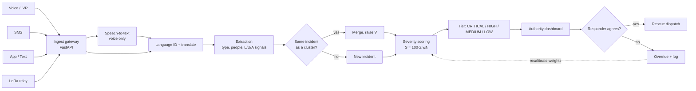

# Architecture

## Pipeline

## Code map

| Stage | Module |
|---|---|
| Ingest | `backend/app/api/reports.py` |
| Speech-to-text | `backend/app/services/stt.py` |
| Translation | `backend/app/services/translate.py` |
| Extraction | `backend/app/services/extraction.py` |
| Embeddings | `backend/app/services/embeddings.py` |
| Duplicate detection | `backend/app/services/dedup.py` |
| Scoring | `backend/app/services/scoring.py` |
| Orchestration | `backend/app/services/pipeline.py` |
| Ranked queue, override, status | `backend/app/api/incidents.py` |
| Dashboard | `frontend/src/App.jsx` |

## Design decisions

**Adapters with offline fallbacks.** STT, translation and embeddings sit behind small protocols.
The defaults need no model download, so the project runs and tests on any laptop; real models
are switched on with environment variables and `requirements-ml.txt`.

**Transparent scoring.** The score is a weighted sum of five named factors, and the API returns
the factor breakdown with every incident. A responder can see why something ranked where it did.

**Human in the loop.** Overrides change the *effective* tier but never overwrite the AI tier, and
each one is written to `override_logs` for later weight calibration.

**Factors take the strongest evidence in a cluster.** If any report in a cluster describes people
trapped, the cluster has a high life-threat factor, even if other reports are vaguer.

**Dedup requires all three signals** (semantic, spatial, temporal). Semantic similarity alone
would merge unrelated floods that use similar words; location and time keep clusters honest.
Reports without a location fall back to semantic and temporal matching only.

## Known limits of the framework stage

- The built-in embedder is lexical (hashed word and character n-grams). It handles near-paraphrase
  but not true semantic similarity or other languages. Sentence-BERT is the intended upgrade, and
  the similarity threshold must be re-tuned when it is switched on.
- Extraction is keyword rules over English text. Every pattern and weight is a proposal to be
  calibrated with domain experts, not a validated model.
- No authentication yet. Override and status endpoints must be protected before any real use.
